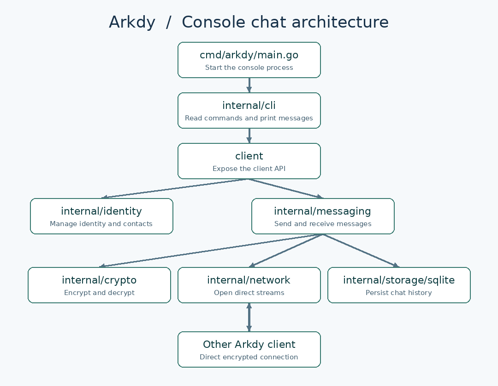

# Arkdy · First console milestone

Two people can exchange encrypted text over a direct connection, restart their clients, and reopen the conversation. Develop with two profiles on one machine first, then repeat on the same LAN.

## Architecture

The console starts the CLI, which calls the shared client API. The client manages identity and messaging. Messaging uses encryption, SQLite storage, and a direct network stream to the other client.

## Components

| Files | Responsibility |
|---|---|
| `cmd/arkdy/main.go` | Handle interrupts, pass arguments to the CLI, and return the process exit code. |
| `internal/cli/commands.go`, `terminal.go` | Parse commands and flags. During chat, read typed lines and display incoming messages. |
| `client/client.go` | Open a profile, add contacts, start listening, and send messages through an API the Android UI can later use. |
| `internal/identity/identity.go`, `contacts.go` | Persist identities, export invites with a public identity and reachable address, and import and verify contacts. |
| `internal/network/host.go`, `direct.go` | Start a libp2p host, listen for peers, and open a messaging stream to an invited peer. |
| `internal/messaging/service.go`, `envelope.go` | Handle incoming and outgoing text, assign message IDs, and associate messages with conversations. |
| `internal/crypto/sessions.go` | Integrate the chosen E2EE implementation and manage encryption sessions. |
| `internal/storage/sqlite/store.go`, `transactions.go` | Persist contacts, conversation history, and session updates across restarts. |

## Completion test

1. Start two clients with separate profile directories and listening ports. Run `arkdy init` for each and use `arkdy id` to confirm distinct identities.
2. Exchange contact records using `arkdy invite` and `arkdy contacts add`. Verify the contact fingerprints.
3. Open `arkdy chat`. Send “hello” from Alice to Bob and a reply from Bob to Alice over the direct encrypted connection.
4. Restart both clients and reopen the conversation. Both profiles should retain the same contacts and both messages.
5. Repeat on two machines on the same LAN using reachable addresses.

Relay fallback and offline mailboxes belong to the next connectivity milestone, when work begins on `arkdy-node`.
